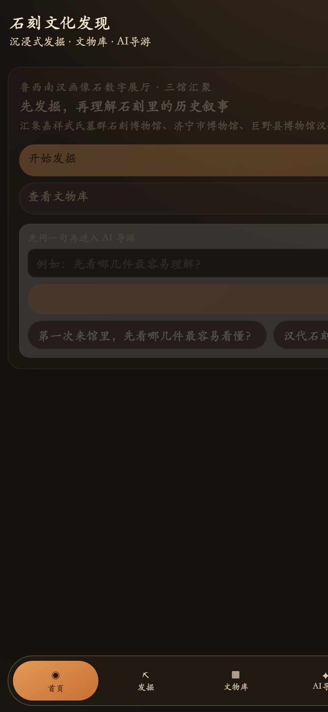
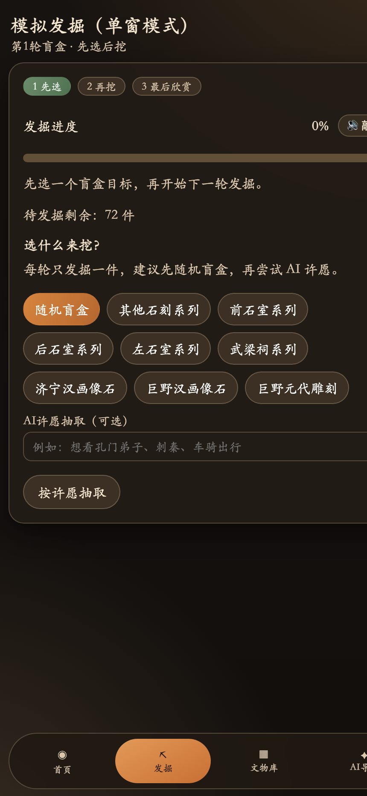
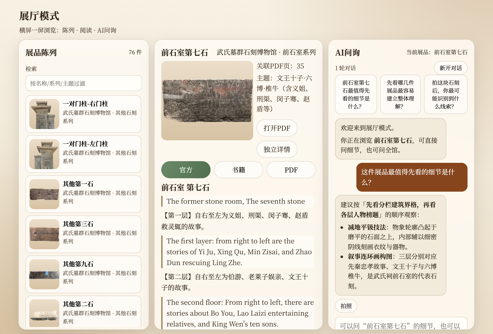
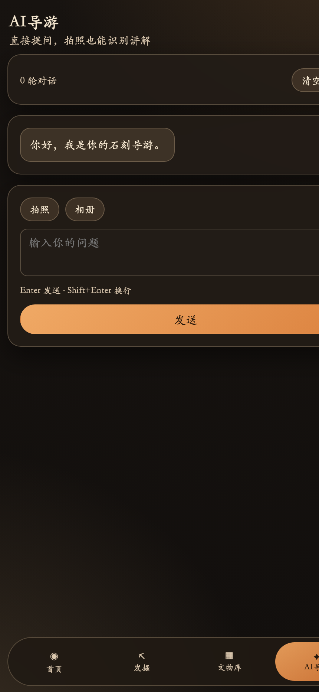
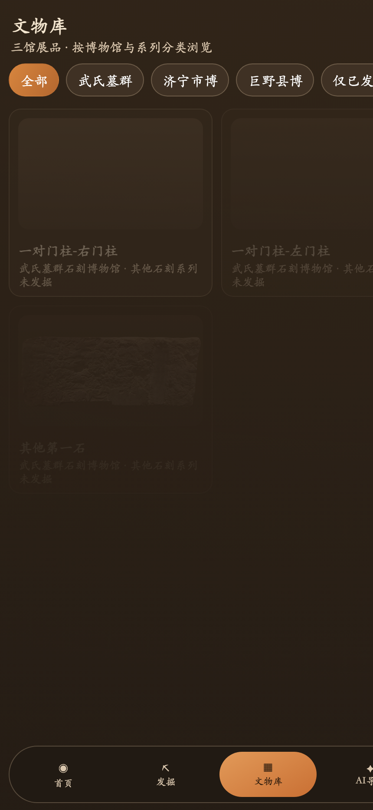

# 🏺 石刻文化发现应用 (Stone Carving Discovery App)

<p align="center">
  <b>基于 Three.js + React 18 + Vite 的非遗石刻文物虚拟探掘与 AI 导览研学 Web 应用</b><br>
  An Interactive 3D Cultural Heritage Discovery Web App with Virtual Excavation &amp; AI-Guided Storytelling
</p>

<p align="center">
  
  
  
  
  
  
</p>

---

## 🏛️ 实机界面预览 (Live App Interface)

<p align="center">
  
  
</p>

<p align="center">
  <i>左图：非遗石刻文化发现首页 | 右图：3D 虚拟地层探掘交互（毛刷清淤与文物出土）</i>
</p>

---

## 🌟 核心特性与多场景画廊 (Feature Showcase)

| 🏛️ 数字展厅与流派编年 (Exhibit Hall) | 🔍 文物 3D 全景交互与档案 (Artifact Detail) |
| :---: | :---: |
|  |  |
| **全景展厅浏览**：按历史朝代与雕刻技法分类，多维矩阵式呈现青州石造像与历代拓片。 | **三维交互鉴赏**：Three.js 驱动模型 360° 无死角缩放观察，结合出土铭文与拓片详尽考证。 |

| 🤖 AI 文化向导伴游对话 (AI Guide) | 🏆 个人数字文物馆藏 (My Collection) |
| :---: | :---: |
|  |  |
| **大模型伴游解说**：结合石刻历史专业知识库，实时解答造像工艺、纹样寓意与历史渊源。 | **探掘图鉴与成就体系**：记录用户挖掘足迹，逐步解锁被埋没的古代珍宝与印章成就。 |

---

## 📖 项目简介 (Overview)

**石刻文化发现应用** 是针对非物质文化遗产（古代石雕艺术、佛教造像与汉画像石）数字化活化传播而开发的沉浸式研学交互 Web 应用。

系统摒弃了传统静态图文陈列的单向展示形式，利用 WebGL / Three.js 实现了**「地层探测 → 虚拟手铲探掘 → 文物 3D 全景鉴赏 → AI 文化伴游 → 个人馆藏沉淀」**的闭环交互体验，大幅提升了传统文化的数字交互趣味性与研学深度。

---

## 🛠️ 技术栈清单 (Tech Stack)

- **核心框架**：React 18 + TypeScript + Vite 6
- **三维渲染引擎**：Three.js + GLTFLoader + OrbitControls (WebGL 2.0)
- **动效与视觉**：Tailwind CSS + GSAP (@gsap/react) + Framer Motion
- **文献与图鉴解析**：PDF.js (pdfjs-dist)
- **大模型集成**：OpenAI 兼容协议客户端与流式对话组件

---

## 📦 项目代码组织 (Directory Structure)

```text
stone-carving-discovery-app/
├── assets/
│   └── screenshots/         # 6 组 2x Retina 高清实机截屏 (尺寸 860x1864 统一无变形)
├── app/
│   ├── src/
│   │   ├── pages/           # 页面组件 (HomePage, ExcavationPage, ExhibitHallPage...)
│   │   ├── components/      # 3D 画布容器、考古工具箱、底部导航 BottomNav
│   │   ├── three/           # Three.js 场景构建、光照、粒子系统与摄像机控制器
│   │   ├── lib/             # 文物探掘状态管理与本地持久化 Hook (useDiscovery)
│   │   └── data/            # 完整石雕文物数字化元数据与历史考据
│   └── public/              # 3D GLB 模型资产与纹理贴图
└── package.json
```

---

## 🚀 快速开始 (Quickstart)

### 1. 克隆与安装依赖

```bash
git clone https://github.com/Evan-Joseph/stone-carving-discovery-app.git
cd stone-carving-discovery-app/app
npm install
```

### 2. 启动本地开发服务

```bash
npm run dev
```

在浏览器打开 `http://localhost:5173` 即可体验。

### 3. 构建生产包

```bash
npm run build
npm run preview
```

---

## 📄 开源许可证 (License)

本项目采用 [MIT License](LICENSE) 开源。
