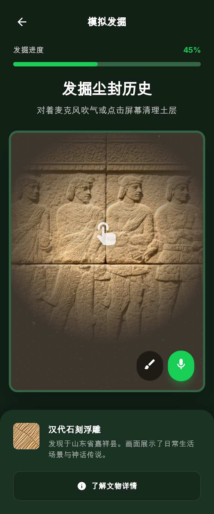
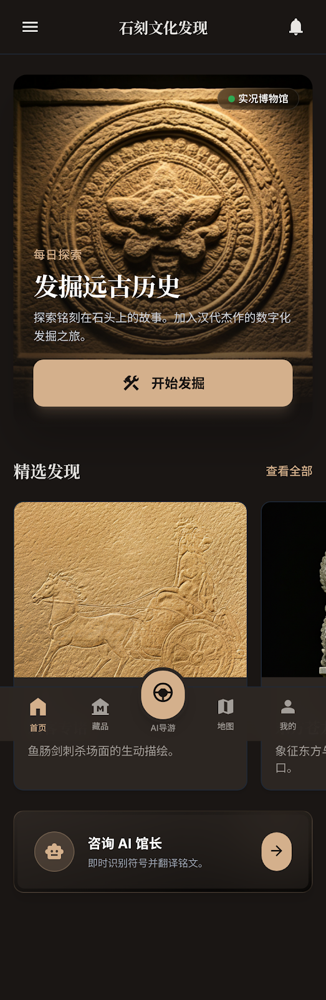
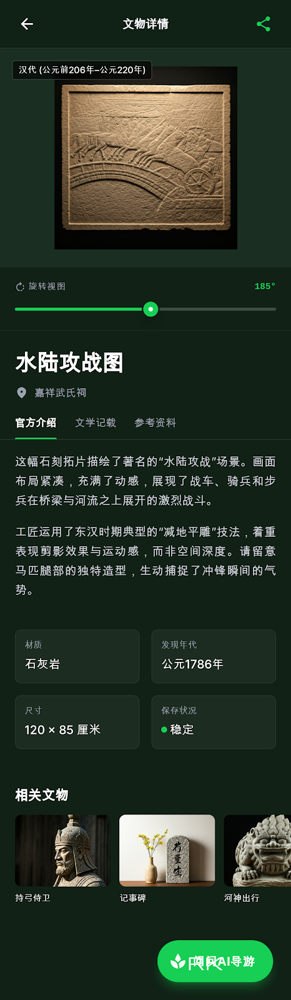
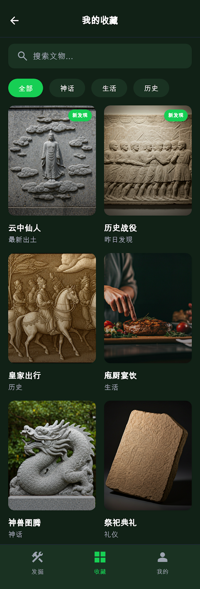

# 🏺 Stone Carving Discovery App (石韵流芳)

<p align="center">
  <b>An Interactive 3D Cultural Heritage Discovery Web App</b><br>
  基于 Three.js + React + Vite 的非遗石雕文化虚拟探掘与 AI 导览研学 Web 应用
</p>

<p align="center">
  
  
  
  
  
  
</p>

---

## 🏛️ 3D 虚拟考古探掘体验 (Hero Preview)

<p align="center">
  
</p>

<p align="center">
  <i>实时三维泥土粒子剔除、手铲/毛刷拟真工具交互与地下石雕文物出土动效</i>
</p>

---

## 🌟 核心特性与多场景画廊 (Feature Showcase)

| 🏛️ 非遗石雕数字漫游首页 | 🔍 文物 3D 全景交互与历史档案 |
| :---: | :---: |
|  |  |
| **文化图景导览**：时代编年史、地域流派分类检索与数字展馆快速入口。 | **三维高精度观察**：支持 360° 旋转缩放、材质光影渲染与工艺技法结构透析。 |

| 🤖 AI 文化向导伴游对话 | 🏆 我的数字文物馆藏集锦 |
| :---: | :---: |
|  |  |
| **智能对话导览**：结合非遗数据库与大模型，解答石雕纹样寓意与民俗背景。 | **成就与馆藏管理**：记录用户的探掘里程碑、点亮图鉴印章与证书生成。 |

---

## 📖 项目简介 (Overview)

**Stone Carving Discovery App** 是针对非物质文化遗产（石雕艺术与古代石刻）数字化传播而打造的沉浸式研学交互 Web 应用。

项目以 Web 端三维图形技术（Three.js）为核心，摆脱了传统博物馆静态图文浏览的枯燥模式，开创性地设计了**「虚拟地层探测 → 拟真手铲清淤 → 文物出土修复 → 3D 鉴赏 → AI 伴游科普」**的闭环互动流程，让用户在趣味探掘中感受非遗文化的历史厚重感。

---

## 🛠️ 技术栈清单 (Tech Stack)

- **三维图形引擎**：Three.js + GLTFLoader + OrbitControls (支持 WebGL 2.0 渲染)
- **前端架构**：React 18 + Vite 5 + TypeScript
- **界面交互**：Tailwind CSS + Lucide Icons + Framer Motion
- **多媒体与音效**：HTML5 Audio API (探掘触碰清脆音效、古琴禅意背景音)
- **大模型集成**：OpenAI 兼容协议客户端与流式对话组件

---

## 📦 项目结构 (Directory Structure)

```text
stone-carving-discovery-app/
├── assets/
│   └── screenshots/         # 5 组高清界面实机预览图
├── app/
│   ├── src/
│   │   ├── components/      # 3D 画布容器、考古工具箱、AI 对话抽屉
│   │   ├── three/           # Three.js 场景构建、光照、粒子系统与摄像机控制器
│   │   ├── hooks/           # 手势监听、音效触发与文物图鉴 Hook
│   │   └── data/            # 石雕文物多维元数据与历史考证档案
│   └── public/              # 3D GLTF/GLB 模型文件与纹理贴图
└── package.json
```

---

## 🚀 快速开始 (Quickstart)

### 1. 克隆与安装依赖

```bash
git clone https://github.com/Evan-Joseph/stone-carving-discovery-app.git
cd stone-carving-discovery-app/app
npm install
```

### 2. 本地启动开发服务

```bash
npm run dev
```

在浏览器打开 `http://localhost:5173`，即可体验完整的 3D 考古与文化漫游。

---

## 📄 开源许可证 (License)

本项目采用 [MIT License](LICENSE) 开源。
