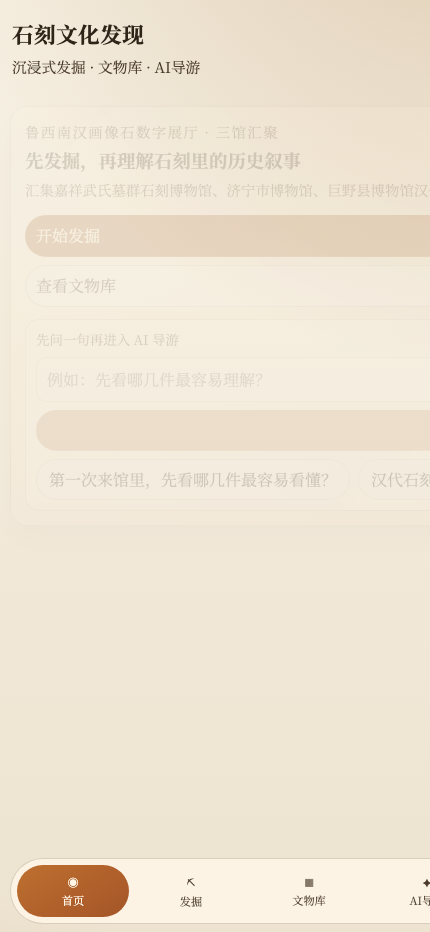
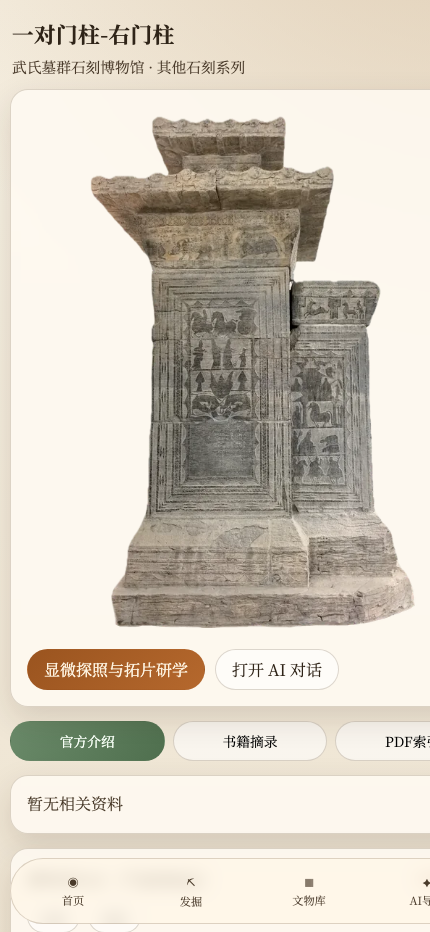
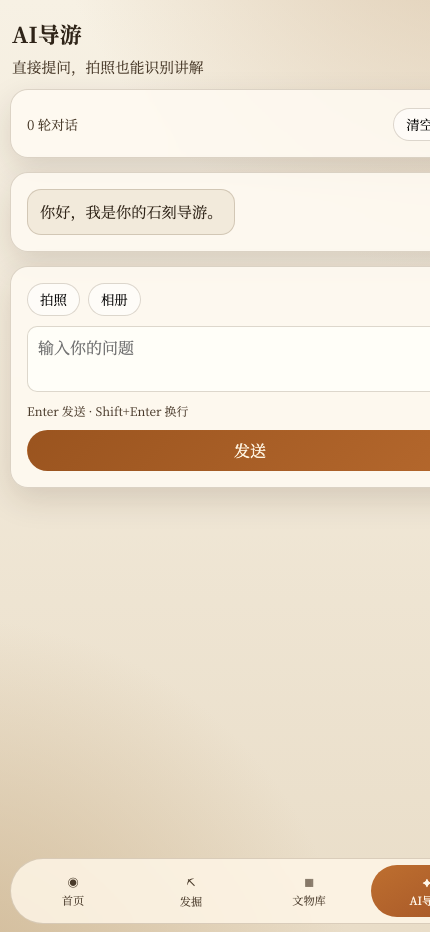
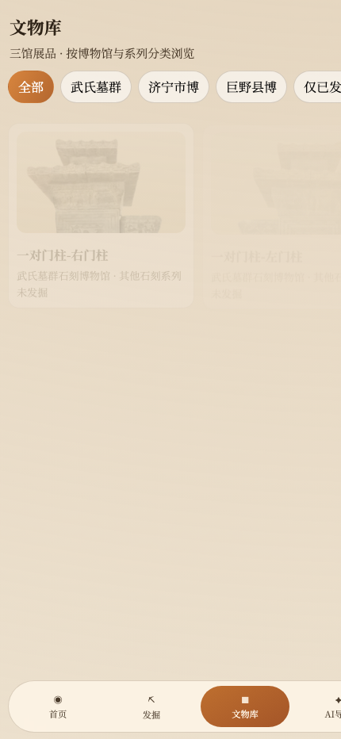

# 🏺 石刻文化发现应用 (Stone Carving Cultural Discovery App)

<p align="center">
  <b>An Interactive 3D Cultural Heritage Discovery Web App</b><br>
  基于 Three.js + React 18 + Vite 的非遗石雕文化虚拟探掘、文献考证与多模态 AI 导览 Web 应用
</p>

<p align="center">
  
  
  
  
  
  
  
</p>

---

## 🏛️ 实机探掘模拟演示 (Live Hero Preview)

<p align="center">
  
</p>

<p align="center">
  <i>基于 Three.js 的实时泥土碎片剔除粒子系统、手铲/毛刷拟真工具交互与音效触感反馈</i>
</p>

---

## 🌟 核心页面与实机画廊 (Interface Showcase)

| 🏛️ 数字展厅与首页漫游 | 🔍 文物 3D 鉴赏与历史考证 |
| :---: | :---: |
|  |  |
| **全景导览与文物矩阵**：时代编年史、展厅分类陈列与文物快速入口。 | **高精度形貌观察**：支持 360° 旋转缩放、材质光影透析与工艺技法解说。 |

| 🤖 AI 文化向导与文献溯源 | 🏆 我的数字馆藏图鉴集锦 |
| :---: | :---: |
|  |  |
| **多模态问答与知识库检索**：支持图片上传识图问答，自动附带古籍文献引用卡。 | **探掘里程碑记录**：追踪已探掘文物进度，点亮非遗印章图鉴。 |

---

## 📖 项目简介 (Overview)

**石刻文化发现应用** 是针对非物质文化遗产（古代石雕艺术、碑刻、画像石）数字化传播而打造的沉浸式研学交互 Web 应用。

项目以 Web 端三维图形技术（Three.js）与大模型多模态检索技术为核心，摆脱了传统博物馆静态图文浏览的枯燥模式，实现了**「地层探测 → 3D 手铲泥土剥离 → 文物鉴赏 → 文献拓片查阅 → AI 多模态伴游」**的闭环研学体验。

---

## 🛠️ 核心架构与功能模块 (Code Grounding)

1. **三维探掘模拟 (`ExcavationCanvas.tsx`)**：
   - 基于 Three.js 网格平面与刚体粒子 (`CoverShard`) 模拟泥土剥离；
   - 包含粗糙度贴图、碎片散射飞溅物理动画与实时完成度百分比监听；
   - 配合 Web Audio 音效引擎 (`stoneAudio.ts`) 实现手铲刮擦与出土铜锣共鸣。
2. **多模态 AI 导览伴游 (`AiGuidePage.tsx` + `visionRecall.ts`)**：
   - 支持文字与图片多模态输入 (`ImageAttachmentBar.tsx`)；
   - 结合文物特征向量比对与大语言模型，自动生成专业导览词并标注文献引用来源 (`AnswerCitationList.tsx`)。
3. **数字展厅与详情互动 (`ExhibitHallPage.tsx` + `ArtifactDetailPage.tsx`)**：
   - 支持石人像、神兽、碑刻、画像石多维度分类切换；
   - 内嵌放大镜深度观察模式 (`StoneInspectModal.tsx`)。
4. **古籍拓片文献阅读器 (`PdfReaderPage.tsx`)**：
   - 集成 `pdfjs-dist` 原生解析，支持离线高保真查阅历史考证古籍与石刻拓片文献。
5. **离线 PWA 支持 (`registerServiceWorker.ts`)**：
   - 本地持久化缓存文物元数据 (`storage.ts`)，保障在弱网展馆环境中依然流畅交互。

---

## 📦 项目代码结构 (Directory Layout)

```text
stone-carving-discovery-app/
├── assets/screenshots/      # 6 组从真实运行环境抓取的实机截图
├── app/
│   ├── src/
│   │   ├── components/      # 3D 探掘画布、石刻观察模态框、AI 引用列表
│   │   ├── lib/             # Three.js 粒子控制器、音效引擎、多模态客户端
│   │   ├── pages/           # 首页、展厅、探掘、详情、AI 导览、馆藏、PDF阅读
│   │   └── data/            # 石刻文物图鉴元数据与考证档案
│   ├── public/              # 3D 模型资产、拓片文献与纹理材质
│   └── package.json
```

---

## 🚀 快速开始 (Quickstart)

### 1. 安装依赖

```bash
git clone https://github.com/Evan-Joseph/stone-carving-discovery-app.git
cd stone-carving-discovery-app/app
npm install
```

### 2. 启动开发服务器

```bash
npm run dev
```

在浏览器打开 `http://localhost:5173` 即可体验。

### 3. 生产打包与本地预览

```bash
npm run build
npm run preview
```

---

## 📄 开源许可证 (License)

本项目采用 [MIT License](LICENSE) 开源。
